<p align="center">
  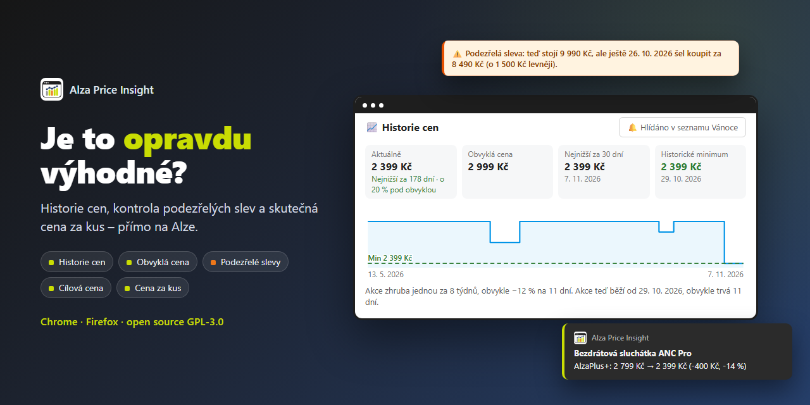
</p>

<p align="center">
  <a href="https://chromewebstore.google.com/detail/alza-price-insight/ndaheikijjhppooeiioljekolkekfgie"></a>
  &nbsp;
  <a href="https://addons.mozilla.org/firefox/addon/alza-price-insight/"></a>
</p>

<p align="center">
  <a href="https://chromewebstore.google.com/detail/alza-price-insight/ndaheikijjhppooeiioljekolkekfgie"></a>
  
  
  <a href="LICENSE"></a>
</p>

**Alza Price Insight** je rozšíření pro Chrome a Firefox, které vám na Alze řekne, jestli je cena opravdu výhodná. Ukazuje historii cen, hlídá vaše nákupní seznamy na pozadí, upozorní na podezřelé slevy a spočítá skutečnou cenu za kus. Funguje na alza.cz, alza.sk a alza.hu.

> **Neoficiální projekt.** Rozšíření nemá žádnou vazbu na Alza.cz a.s. Název „Alza“ je ochranná známka svého vlastníka a je zde použit jen k označení webu, se kterým rozšíření pracuje.

**Obsah:** [Co umí](#co-umí) · [Jak to vypadá](#jak-to-vypadá) · [Jak začít](#jak-začít) · [Nastavení](#nastavení) · [Časté otázky](#časté-otázky) · [Soukromí](#soukromí) · [English](#english) · [Pro vývojáře](#pro-vývojáře)

## Co umí

- 📈 **Historie cen** v nákupních seznamech a na detailu produktu, včetně grafu s typy cen, dostupností a minimem/maximem.
- 🔔 **Hlídání seznamů na pozadí** s notifikacemi při změně ceny. Počet změn se zobrazuje na ikoně rozšíření.
- 🎯 **Cílová cena** u hlídaných produktů, a to i cílová cena za kus.
- ⚠️ **Podezřelé slevy:** porovnání přeškrtnuté ceny s obvyklou cenou a hodnocení, jestli je aktuální cena opravdu výhodná.
- ⏳ **Vyplatí se počkat?** Rytmus akcí: jak často a o kolik produkt obvykle zlevňuje.
- 📦 **Stejný produkt levněji:** upozornění na rozbalený nebo zánovní kus.
- 🧾 **Lišta nákupního seznamu** se souhrnem, filtry a řazením.
- 🧮 **Skutečná cena za kus** v kategoriích, v nákupním seznamu i na detailu produktu (i se slevou AlzaPlus+) a řazení celé kategorie podle ní.
- 💾 **Záloha dat:** export do JSON, export historie do CSV, obnova ze zálohy a úklid starých dat.

Rozhraní je v češtině, slovenštině, maďarštině a angličtině.

## Jak to vypadá

<table>
  <tr>
    <td width="50%">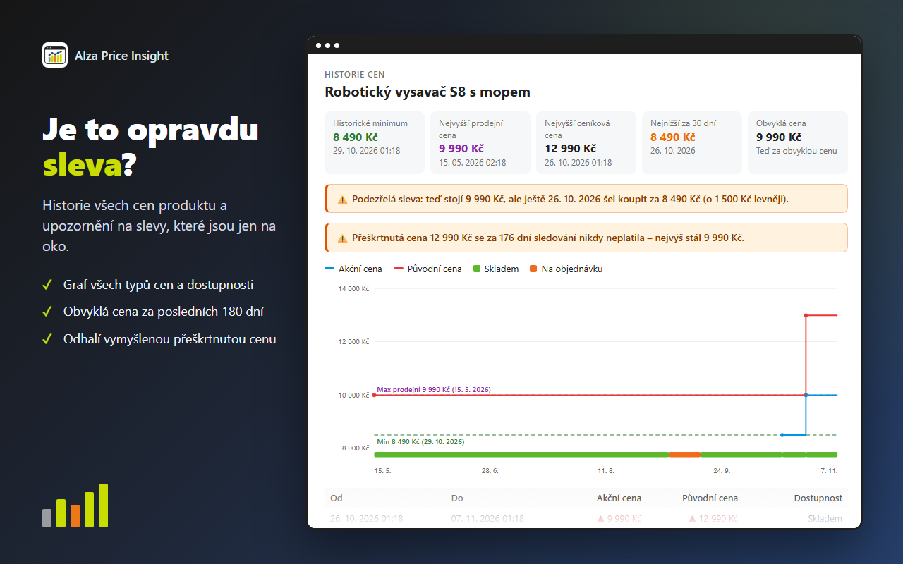<br><sub><b>Historie cen</b> a odhalení slev, které jsou jen na oko</sub></td>
    <td width="50%">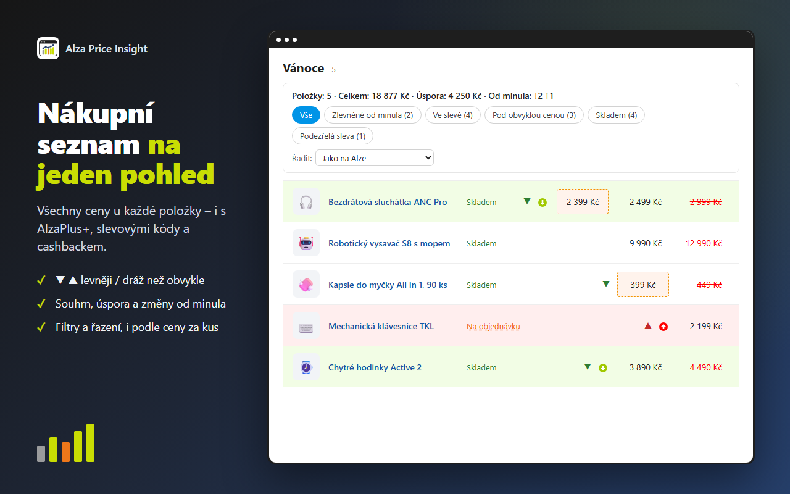<br><sub><b>Nákupní seznam</b> na jeden pohled: souhrn, filtry a řazení</sub></td>
  </tr>
  <tr>
    <td>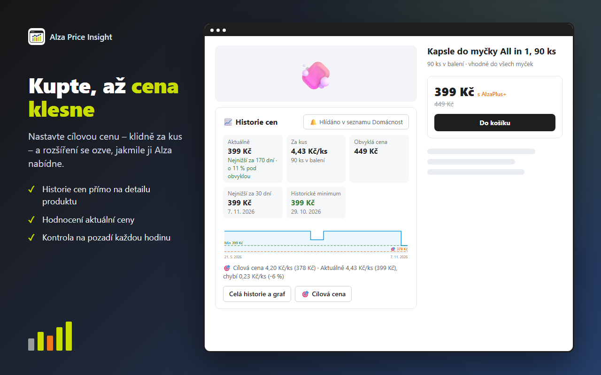<br><sub><b>Cílová cena</b> přímo na detailu produktu, klidně za kus</sub></td>
    <td>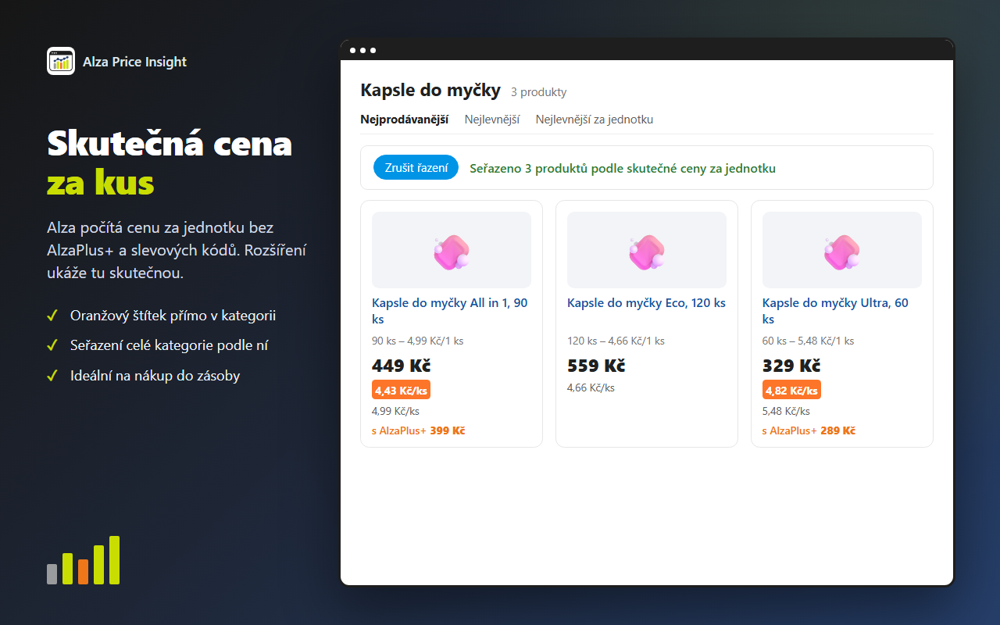<br><sub><b>Skutečná cena za kus</b> v kategorii a řazení podle ní</sub></td>
  </tr>
  <tr>
    <td>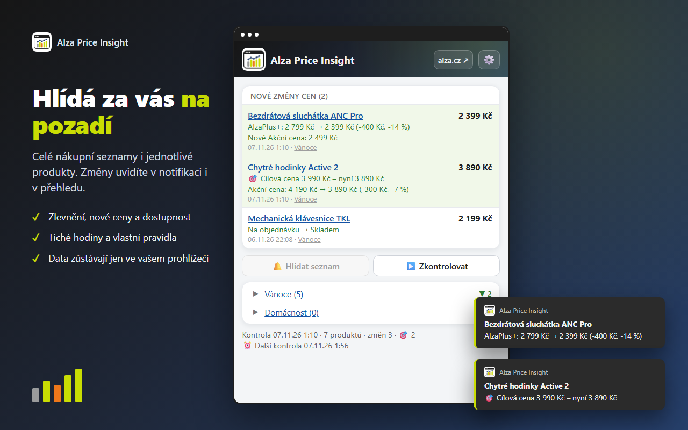<br><sub><b>Hlídání na pozadí</b> s notifikacemi a přehledem změn</sub></td>
    <td valign="middle" align="center">
      <b>Zdarma a bez reklam.</b><br><br>
      <a href="https://chromewebstore.google.com/detail/alza-price-insight/ndaheikijjhppooeiioljekolkekfgie">Chrome Web Store</a> ·
      <a href="https://addons.mozilla.org/firefox/addon/alza-price-insight/">Firefox Add-ons</a>
    </td>
  </tr>
</table>

## Jak začít

### 1. Nainstalujte rozšíření

| Prohlížeč | Kde | Požadavky |
|---|---|---|
| **Chrome** | [Chrome Web Store](https://chromewebstore.google.com/detail/alza-price-insight/ndaheikijjhppooeiioljekolkekfgie) | Chrome 121 nebo novější |
| **Firefox** pro počítač | [Firefox Add-ons](https://addons.mozilla.org/firefox/addon/alza-price-insight/) | Firefox 140 nebo novější (ne Android) |

Potřebujete jen účet na Alze. Registrace je zdarma a rozšíření s ním pracuje stejně jako vy v prohlížeči.

### 2. Projděte průvodce nastavením

Po instalaci se sám otevře průvodce. Zabere asi minutu a později ho kdykoli spustíte znovu z nastavení tlačítkem **🧭 Průvodce**.

<p align="center">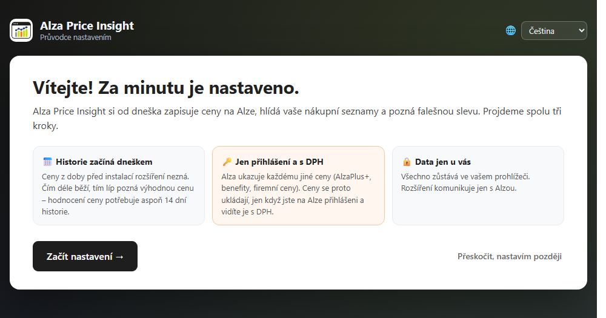</p>

Úvod shrnuje, co je dobré vědět předem: historie začíná instalací, ceny se ukládají jen přihlášenému s cenami s DPH a všechna data zůstávají ve vašem prohlížeči. Pak následují tři kroky:

<table>
  <tr>
    <td width="50%" valign="top">
      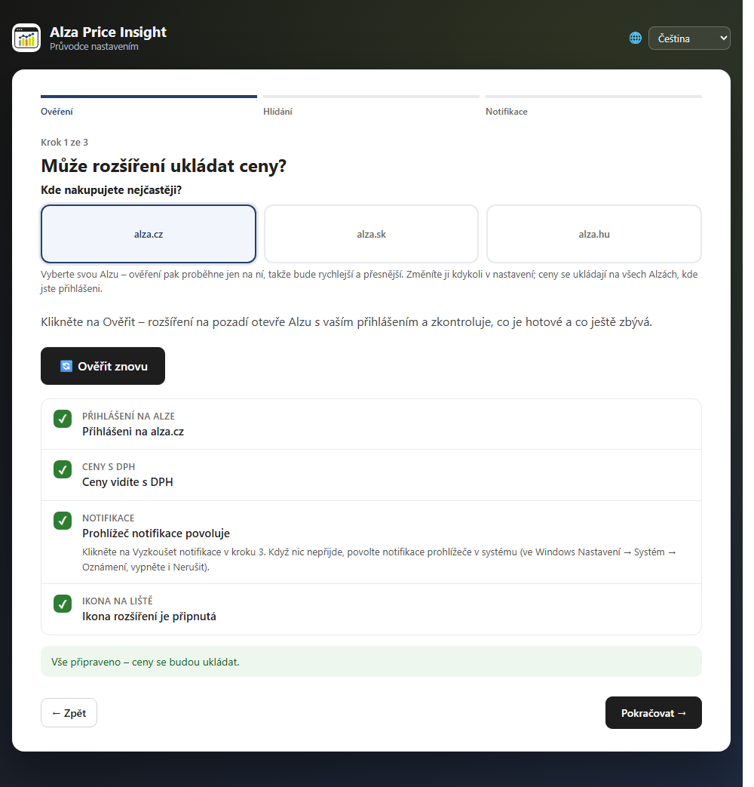
      <p><b>Krok 1 – Ověření.</b> Vyberte svou Alzu a klikněte na <b>🔍 Ověřit</b>. Rozšíření na pozadí zkontroluje, že jste přihlášeni, vidíte ceny s DPH, prohlížeč povoluje notifikace a ikona je připnutá na liště. Co chybí, je červeně i s návodem. Po přihlášení na Alze se stačí vrátit do záložky průvodce a ověření proběhne znovu samo.</p>
    </td>
    <td width="50%" valign="top">
      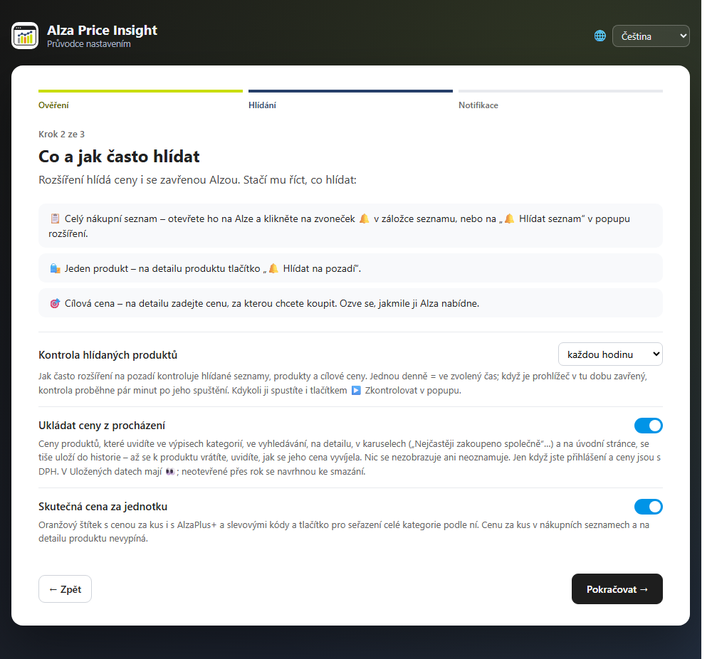
      <p><b>Krok 2 – Hlídání.</b> Jak často kontrolovat hlídané produkty (každou hodinu až jednou denně ve zvolený čas), jestli ukládat ceny i z procházení Alzy a jestli ve výpisech kategorií ukazovat skutečnou cenu za kus. Každá změna se hned uloží.</p>
    </td>
  </tr>
  <tr>
    <td valign="top">
      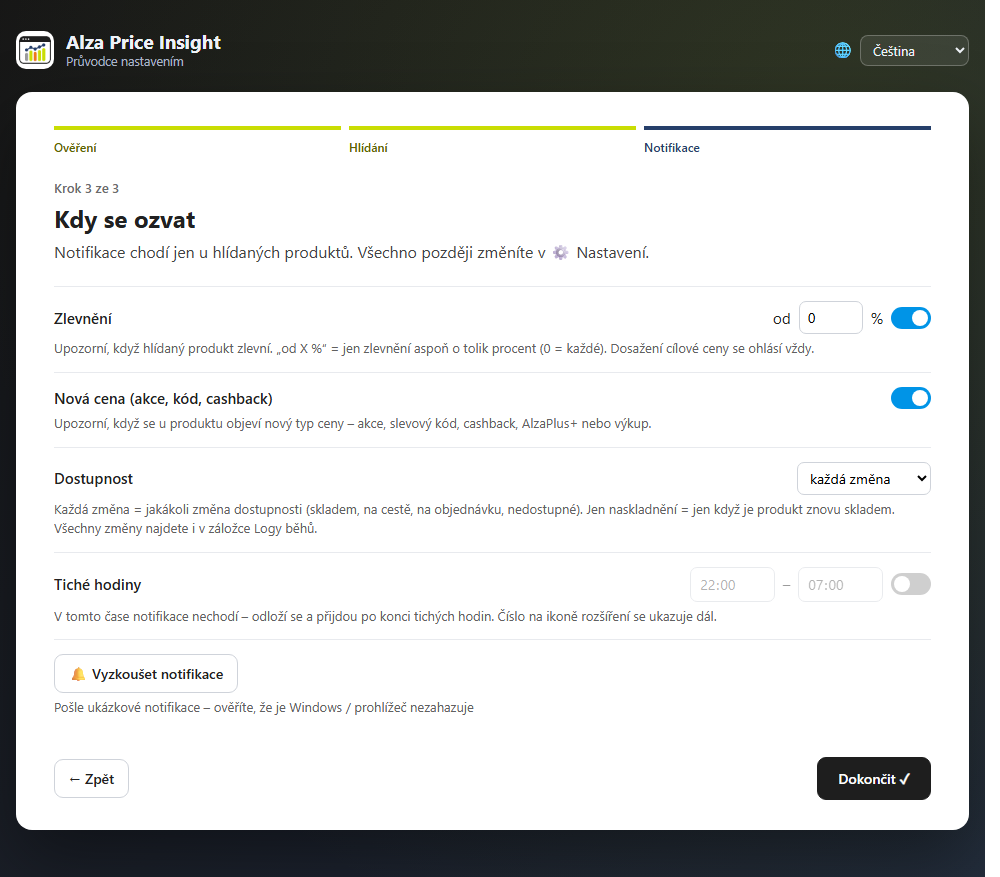
      <p><b>Krok 3 – Notifikace.</b> Kdy se ozvat: zlevnění (třeba až od 5 %), nová cena (akce, slevový kód, cashback), změna dostupnosti a tiché hodiny. Tlačítkem <b>🔔 Vyzkoušet notifikace</b> ověříte, že je Windows nebo prohlížeč nezahazuje.</p>
    </td>
    <td valign="top">
      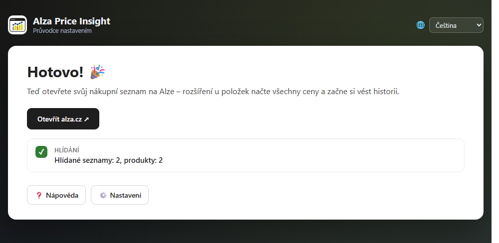
      <p><b>Hotovo.</b> Otevřete svůj nákupní seznam na Alze. Rozšíření u položek načte všechny ceny a začne si vést historii. Průvodce ukáže, kolik seznamů a produktů už hlídáte.</p>
    </td>
  </tr>
</table>

### 3. Řekněte rozšíření, co hlídat

Rozšíření kontroluje ceny i se zavřenou Alzou. Stačí mu říct co:

- 📋 **Celý nákupní seznam:** otevřete ho na Alze a klikněte na zvoneček 🔔 v záložce seznamu, nebo na **🔔 Hlídat seznam** v popupu rozšíření.
- 🛍️ **Jeden produkt:** na detailu produktu klikněte na **🔔 Hlídat na pozadí** v kartě rozšíření pod fotkami.
- 🎯 **Cílová cena:** na detailu produktu klikněte na **🎯 Cílová cena** a zadejte cenu, za kterou chcete koupit. Rozšíření se ozve, jakmile ji Alza nabídne. Jde zadat i cena za kus.

### 4. Sledujte změny

Změny cen přijdou jako notifikace a jejich počet svítí na ikoně rozšíření. Po kliknutí na ikonu je v popupu přehled změn od minula, hlídané seznamy a tlačítko **▶️ Zkontrolovat** pro okamžitou kontrolu. Viz snímek *Hlídání na pozadí* [výše](#jak-to-vypadá).

## Nastavení

Nastavení otevřete z popupu (ozubené kolečko ⚙️) nebo pravým tlačítkem na ikonu rozšíření → *Možnosti*. Volby jsou stejné jako v průvodci, navíc tu je jazyk, záloha dat a diagnostika.

<p align="center">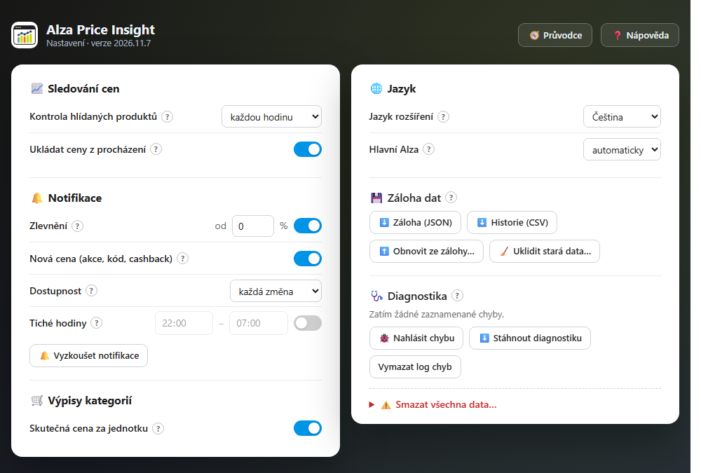</p>

- **Sledování cen:** jak často kontrolovat hlídané produkty a jestli ukládat ceny z procházení.
- **Notifikace:** zlevnění od zvoleného procenta, nové ceny, dostupnost, tiché hodiny a zkušební notifikace.
- **Výpisy kategorií:** skutečná cena za jednotku na oranžovém štítku.
- **Jazyk:** jazyk rozšíření a hlavní Alza (cz, sk, hu).
- **Záloha dat:** **Záloha (JSON)** stáhne všechna data včetně historie cen, **Obnovit ze zálohy…** je vrátí. **Historie (CSV)** se otevře v Excelu, **Uklidit stará data…** smaže to, co už nepotřebujete.
- **Diagnostika:** **🐞 Nahlásit chybu** otevře na GitHubu nové hlášení s předvyplněnou verzí, prohlížečem a posledními chybami (odešle se, až ho sami potvrdíte). **Stáhnout diagnostiku** uloží log chyb do souboru.

Pod volbami jsou záložky s tím, co rozšíření hlídá a ukládá:

<p align="center">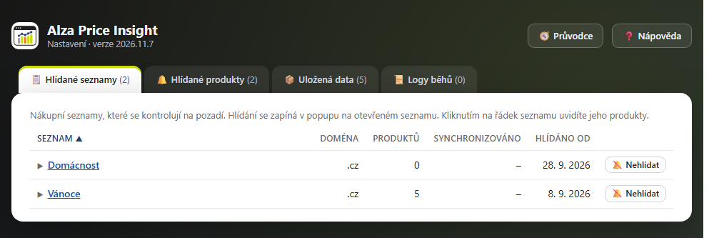</p>
<p align="center">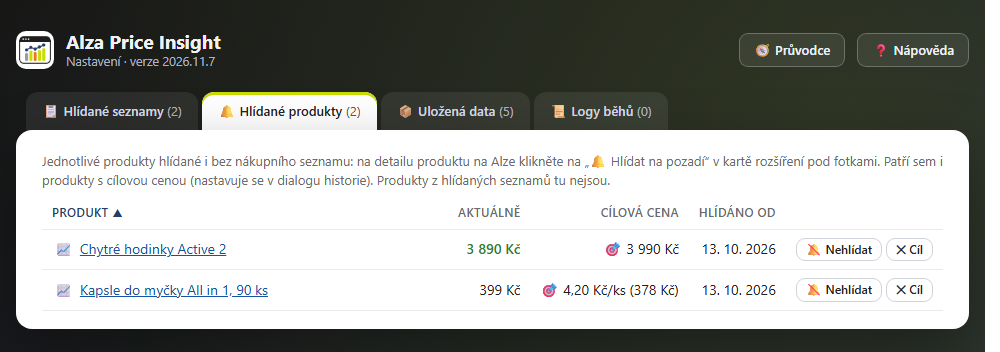</p>

- **Hlídané seznamy:** kolik mají produktů, od kdy se hlídají. Kliknutím na řádek uvidíte produkty seznamu.
- **Hlídané produkty:** jednotlivé produkty a cílové ceny, včetně aktuální ceny.
- **Uložená data:** všechny produkty s historií cen.
- **Logy běhů:** kdy a s jakým výsledkem proběhla kontrola na pozadí.

## Časté otázky

<details>
<summary><b>Proč se mi neukládají ceny?</b></summary>

Ceny se ukládají, jen když jste na Alze přihlášeni a vidíte je s DPH. Nepřihlášený nebo firemní účet vidí jiné ceny, historie by pak nesouhlasila. Spusťte průvodce (**🧭 Průvodce** v nastavení), krok 1 ukáže, co chybí.
</details>

<details>
<summary><b>Proč u produktu nevidím hodnocení ceny?</b></summary>

Historie začíná instalací rozšíření a hodnocení potřebuje aspoň 14 dní záznamů. Do té doby uvidíte jen ceny, které už rozšíření zná.
</details>

<details>
<summary><b>Nechodí mi notifikace.</b></summary>

V průvodci nebo v nastavení klikněte na **🔔 Vyzkoušet notifikace**. Když nic nepřijde, povolte notifikace prohlížeče v systému (Windows: Nastavení → Systém → Oznámení) a vypněte režim Nerušit. Zkontrolujte i tiché hodiny v nastavení.
</details>

<details>
<summary><b>Musí být Alza otevřená?</b></summary>

Nemusí. Hlídané seznamy a produkty se kontrolují na pozadí, stačí mít spuštěný prohlížeč. Když je při kontrole jednou denně prohlížeč zavřený, proběhne pár minut po jeho spuštění.
</details>

<details>
<summary><b>Jak přenesu data na jiný počítač nebo do jiného prohlížeče?</b></summary>

V nastavení klikněte na **Záloha (JSON)** a soubor si uložte. V novém prohlížeči nainstalujte rozšíření a v nastavení použijte **Obnovit ze zálohy…**. Záloha obsahuje historii cen, hlídané seznamy a produkty, cílové ceny i nastavení. Při odinstalaci rozšíření prohlížeč jeho data smaže, proto si zálohu udělejte vždy předem.
</details>

<details>
<summary><b>Funguje to v telefonu?</b></summary>

Ne. Chrome pro Android rozšíření nepodporuje a Firefox pro Android nemá notifikace, které hlídání potřebuje.
</details>

## Soukromí

Všechna data (ceny, historie, nastavení) se ukládají jen lokálně ve vašem prohlížeči. Rozšíření komunikuje výhradně s weby Alzy a nikam jinam nic neodesílá. Nemá žádnou analytiku ani sledování, což si můžete ověřit přímo ve zdrojovém kódu v tomto repozitáři.

## English

**Alza Price Insight** tells you whether a price on Alza (CZ, SK, HU) is really a deal: price history, fake-discount alerts, background watching of your wishlists with notifications, target prices and the real price per piece. Free, no ads, no tracking, all data stays in your browser. The extension speaks English too – switch the language in the setup guide or in the settings.

Install it from the [Chrome Web Store](https://chromewebstore.google.com/detail/alza-price-insight/ndaheikijjhppooeiioljekolkekfgie) or [Firefox Add-ons](https://addons.mozilla.org/firefox/addon/alza-price-insight/). A setup guide opens right after installation. You need to be logged in to Alza and see prices including VAT for prices to be saved. Unofficial project, not affiliated with Alza.cz a.s.

## Chyby a návrhy

Chyby a nápady hlaste přes [Issues](https://github.com/Pnaky/Alza-Price-Insight/issues). Nejrychleji to jde z rozšíření: **Nastavení → Diagnostika → 🐞 Nahlásit chybu** předvyplní verzi, prohlížeč i poslední chyby. Když Alza změní vzhled webu a něco přestane fungovat, pomůže odkaz na stránku a snímek obrazovky. Projekt vzniká ve volném čase, pull requesty přijímám podle uvážení.

Bezpečnostní chyby prosím hlaste neveřejně přes **Security → Report a vulnerability**.

## Pro vývojáře

### Ruční instalace (vývojová verze)

Stáhněte repozitář (**Code → Download ZIP**) a rozbalte ho, nebo ho naklonujte. Stejná složka funguje v obou prohlížečích, bez buildu.

**Chrome** (121 nebo novější)

1. Otevřete `chrome://extensions`.
2. Zapněte **Režim pro vývojáře** vpravo nahoře.
3. Klikněte na **Načíst rozbalené** a vyberte složku s `manifest.json`.

**Firefox** (140 nebo novější)

1. Otevřete `about:debugging#/runtime/this-firefox`.
2. Klikněte na **Načíst dočasný doplněk** a vyberte `manifest.json`. Dočasný doplněk vydrží do zavření Firefoxu.

Rozbalená vývojová verze má v Chrome jiné ID než verze z obchodu, takže má i vlastní data. Při přesunu složky nebo odebrání rozšíření data zmizí, předem si udělejte zálohu (JSON).

### Struktura

| Složka | Co v ní je |
|---|---|
| `src/` | skript na stránkách Alzy (`content.js` a moduly v `content/`), výpisy kategorií (`category.js`), služba na pozadí (`background.js`), popup, nastavení, průvodce (`welcome/`), nápověda (`help/`) |
| `src/shared/` | jádro sdílené všemi částmi (`core.js`) a jediný zapisovatel do úložiště (`store.js`) |
| `src/chrome/`, `src/firefox/` | kód jen pro jeden prohlížeč |
| `_locales/` | název a popis rozšíření v obchodech |
| `tests/` | testy jádra, úložiště, překladů, nápovědy a průvodce |

### Testy

Bez závislostí, stačí Node.js:

```
node --test "tests/*.test.js"
```

## Licence

Copyright (c) 2025–2026 Jan Pňakovič

[GNU GPL v3.0](LICENSE). Kód můžete používat, upravovat a šířit, ale upravené verze musí zůstat pod stejnou licencí a se zdrojovým kódem.
